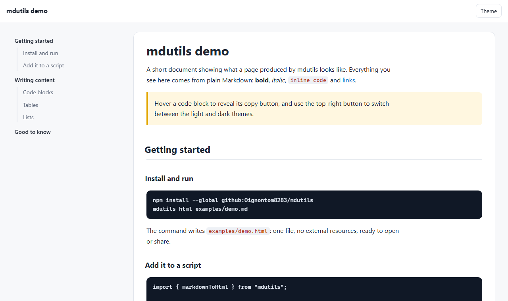

# mdutils

A toolkit to work with Markdown, as a command line tool and as a library for Node.js and the browser.


## Tools

| Tool | Command | What it does |
|---|---|---|
| [Markdown to HTML](#markdown-to-html) | `mdutils html` | Turns a Markdown file into one polished, standalone web page |

## Install

```bash
npm install --global github:Oignontom8283/mdutils     # command line
npm install github:Oignontom8283/mdutils              # library, inside a project
```

Node.js 22 or newer.

Run `mdutils --help` to list the commands and their options.

## Markdown to HTML



- One self-contained HTML file: styles and script included, nothing to download, works offline
- Side menu built from your headings, highlighting the section you are reading
- Light and dark themes that follow the system, with a button to switch and a remembered choice
- Copy button on code blocks, clickable anchors on titles, tables that scroll on small screens
- Responsive layout for phones, clean printing
- GitHub-style heading ids, so links like `#1-getting-started` work
- Raw HTML in Markdown is off by default; turn it on when you trust the source
- Everything is configurable: texts (translations), theme, menu, extra CSS
- Drops into any website with one function call, without its styles touching yours

### From the command line

Convert a file. The page is written next to it:

```bash
mdutils html guide.md            # creates guide.html
```

Choose the output file:

```bash
mdutils html guide.md -o site/index.html
```

Read from standard input, write to standard output:

```bash
cat guide.md | mdutils html - > guide.html
```

Set the language, the title and the starting theme:

```bash
mdutils html guide.md --lang fr --title "My guide" --theme dark
```

Change the name in the top bar, or remove it:

```bash
mdutils html guide.md --site-name "Acme docs"
mdutils html guide.md --no-site-name --no-theme-toggle
```

Remove the side menu, or leave some headings out of it:

```bash
mdutils html guide.md --no-toc
mdutils html guide.md --toc-exclude "Contents" --toc-exclude "Changelog"
```

Translate the texts of the page:

```bash
mdutils html guide.md --lang fr --label theme=Theme --label copy=Copier --label copied="Copie !"
```

Label names: `theme`, `themeTitle`, `copy`, `copied`, `anchor`, `toc`.

Add your own CSS, remove the copy buttons, keep raw HTML:

```bash
mdutils html guide.md --css brand.css --no-copy-buttons --allow-html
```

Choose where the theme choice is remembered, or do not remember it:

```bash
mdutils html guide.md --storage-key acme-theme
mdutils html guide.md --no-storage
```

### In your code

```js
import { markdownToHtml } from "mdutils";
import { writeFileSync } from "node:fs";

const page = markdownToHtml("# Hello\n\n## First part\n\nSome *Markdown*.");
writeFileSync("hello.html", page);
```

Pass options as the second argument:

```js
const page = markdownToHtml(markdown, {
  lang: "fr",
  title: "Ma documentation",
  siteName: "Acme docs",
  theme: "light",
  labels: { theme: "Theme", copy: "Copier", copied: "Copie !" },
  toc: { exclude: ["Contents"], label: (heading) => heading.text.split(" - ")[0] },
  css: "main { max-width: 60rem; }",
});
```

| Option | Default | Effect |
|---|---|---|
| `lang` | `"en"` | Language of the page |
| `title` | first `# heading` | Title of the browser tab |
| `siteName` | the title | Name in the top bar, `false` for none |
| `theme` | `"auto"` | `"auto"`, `"light"` or `"dark"` |
| `themeToggle` | `true` | Show the light/dark button |
| `copyButtons` | `true` | Show copy buttons on code blocks |
| `storageKey` | `"mdutils-theme"` | localStorage key for the theme, `false` to forget it |
| `toc` | `true` | `false` removes the menu, or `{ exclude, label }` to adjust it |
| `labels` | English texts | Replace `theme`, `themeTitle`, `copy`, `copied`, `anchor`, `toc` |
| `css` | none | Extra CSS added after the built-in styles |
| `head` | none | Extra HTML added at the end of `<head>` |
| `script` | `true` | Include the page script (copy buttons, theme button, menu highlight) |
| `html` | `false` | Keep raw HTML found in the Markdown |

Place the content inside your own page with `renderParts`, which gives you the pieces instead of a full page:

```js
import { renderParts } from "mdutils";

const { title, html, toc, css, script } = renderParts(markdown);
// html: the rendered document, toc: the menu entries,
// css and script: what the built-in page uses
```

Get only the converted body and the list of headings with `convert`:

```js
import { convert } from "mdutils";

const { title, html, headings } = convert("# Guide\n\n## Setup\n");
// title: "Guide"
// headings: [{ level: 1, id: "guide", text: "Guide" }, { level: 2, id: "setup", text: "Setup" }]
```

### In a website

`mount` shows a Markdown document, rendered as a full documentation page, inside an element of your site.
The page lives in an iframe, so its styles never leak into your site and yours never leak into it.

With a bundler:

```js
import { mount } from "mdutils";

mount(document.getElementById("docs"), markdown, { siteName: "Acme docs" });
```

With a script tag, no build step:

```html
<div id="docs" style="height: 100vh"></div>
<script src="node_modules/mdutils/dist/mdutils.browser.js"></script>
<script>
  mdutils.mount(document.getElementById("docs"), "# Hello\n\n## First part\n\nSome *Markdown*.");
</script>
```

`mount` accepts every option of `markdownToHtml`, plus:

| Option | Default | Effect |
|---|---|---|
| `height` | `"100%"` | Height of the frame, as a CSS value. Give the container a height |
| `sandbox` | sandboxed only with `html: true` | Value of the iframe `sandbox` attribute, or `false` for none |

In a sandboxed frame the chosen theme cannot be remembered between visits.

`markdownToHtml`, `renderParts` and `convert` also work in the browser if you prefer to build the page yourself,
for example `iframe.srcdoc = markdownToHtml(markdown)`.

## License

MIT
